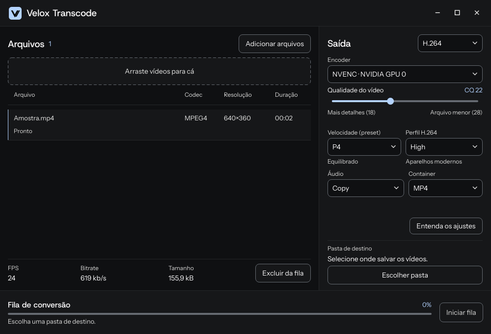
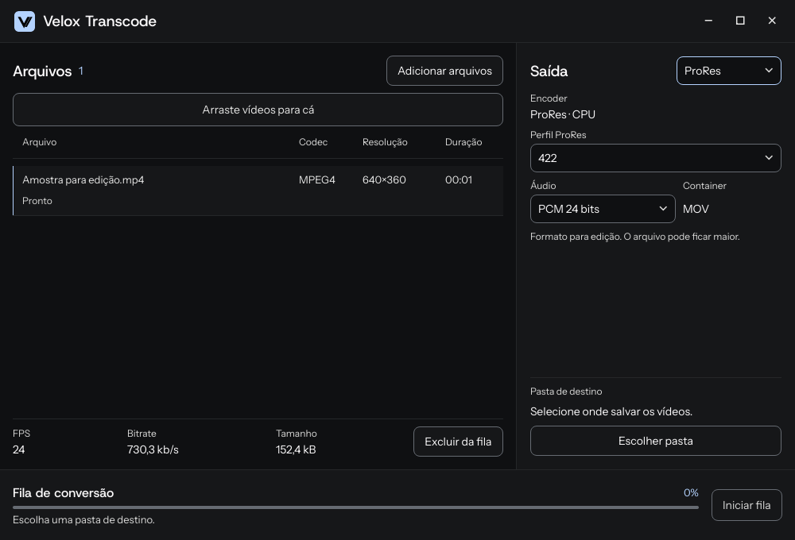

# Velox Transcode

O Velox Transcode é um aplicativo desktop para converter vídeos em lote no próprio computador. Seu objetivo é reunir em uma interface gráfica as tarefas mais comuns de transcodificação: inspecionar os arquivos de origem, escolher o formato de saída, configurar a qualidade e acompanhar o processamento de vários vídeos sem precisar montar comandos FFmpeg manualmente.

O projeto é voltado a quem precisa preparar vídeos em H.264 para reprodução e compartilhamento ou gerar arquivos Apple ProRes para edição. O aplicativo usa FFmpeg e ffprobe para processar e analisar os arquivos; a interface é construída em Rust e Slint com Qt 6. Os arquivos são processados localmente.

## O que o aplicativo faz

- Adiciona vários vídeos por seleção de arquivos, arraste ou abertura pelo gerenciador de arquivos.
- Mostra informações disponíveis da origem, como codec, resolução, taxa de quadros, duração e bitrate.
- Converte para **H.264**, com opções de qualidade, velocidade, perfil, áudio e contêiner. Conforme o ambiente, pode usar CPU com x264 ou aceleração por VA-API ou NVIDIA NVENC.
- Gera **Apple ProRes** em MOV para edição, com perfis 422 Proxy, 422 LT, 422 e 422 HQ, vídeo 4:2:2 de 10 bits e áudio PCM de 24 bits ou cópia quando compatível.
- Executa uma fila com progresso por arquivo e do lote, além de FPS e estimativa de tempo quando disponíveis. É possível cancelar o processamento e receber uma notificação ao fim.
- Preserva os arquivos originais e evita sobrescrever resultados existentes, acrescentando sufixos quando necessário.

A disponibilidade de codecs e aceleração depende da instalação do FFmpeg, dos drivers e do hardware. O aplicativo testa os encoders antes de oferecê-los. ProRes é destinado à edição e pode gerar arquivos maiores que os originais; o tamanho de qualquer saída depende do vídeo e das configurações escolhidas.

## Imagens da aplicação

Interface com um vídeo de exemplo e opções de saída em H.264:



Configuração de saída ProRes para edição:



## Instalação a partir do código-fonte

Baixe ou clone este repositório e execute os comandos abaixo em um terminal, a partir da pasta raiz do projeto. A compilação requer **Rust e Cargo 1.95 ou posterior**, um compilador C++, Qt 6 e FFmpeg com `ffprobe` e pelo menos um encoder compatível. O instalador compila uma versão otimizada usando as dependências fixadas em `Cargo.lock`.

### Fedora Workstation

1. Instale o Rust e o Cargo, por exemplo usando [rustup](https://rustup.rs/), e confirme a versão com `cargo --version`.
2. Instale as dependências do sistema:

   ```sh
   sudo dnf install gcc-c++ pkgconf-pkg-config qt6-qtbase-devel qt6-qtwayland \
     wayland-libs libxkbcommon libxkbcommon-x11 desktop-file-utils ffmpeg-free
   ```

3. Verifique se o FFmpeg oferece pelo menos `libx264`, `h264_vaapi`, `h264_nvenc` ou `prores_ks`:

   ```sh
   ffmpeg -hide_banner -encoders | grep -E 'libx264|h264_vaapi|h264_nvenc|prores_ks'
   ffprobe -version
   ```

   Os codecs disponíveis variam conforme os pacotes instalados. No Fedora 44 usado nos testes, `ffmpeg-free` forneceu os executáveis e `libavcodec-freeworld` forneceu `libx264` e NVENC; este último depende de um repositório de terceiros. A presença de um encoder na lista também não garante que o hardware ou driver consiga iniciá-lo.

4. Compile e instale para o usuário atual:

   ```sh
   ./install.sh
   ~/.local/bin/velox-transcode
   ```

O instalador coloca o executável, o ícone e o atalho em `~/.local`. Depois da instalação, também é possível abrir **Velox Transcode** pelo menu de aplicativos ou usar **Abrir com** em arquivos de vídeo. Para abrir arquivos diretamente pelo terminal, passe seus caminhos ao executável.

Se o Qt não for encontrado durante a compilação, tente `QMAKE=/usr/bin/qmake6 ./install.sh`. A sessão gráfica deve ter um portal de desktop disponível para os seletores de arquivos.

### macOS

Instale as ferramentas de linha de comando da Apple, o [Homebrew](https://brew.sh/) e o Rust com Cargo 1.95 ou posterior. Depois execute:

```sh
xcode-select --install
brew install qtbase ffmpeg
./install.sh
open "$HOME/Applications/Velox Transcode.app"
```

Se as ferramentas da Apple já estiverem instaladas, não é necessário instalá-las novamente. O instalador cria o aplicativo em `~/Applications`, incorpora os frameworks e plugins Qt necessários e registra os caminhos de `ffmpeg` e `ffprobe`. Execute `./install.sh` novamente se esses executáveis mudarem de lugar. Caso haja mais de uma instalação de Qt, use a variável `QMAKE` para apontar para o `qmake` do Qt 6 desejado.

O bundle foi verificado por testes simulados; compilação e uso nativos no macOS, incluindo Finder, Dock e notificações, ainda precisam de validação em um Mac.

### Outras opções de instalação

`./install.sh --help` mostra as opções disponíveis. Use `--prefix DIRETÓRIO` para escolher outro destino ou `--binary CAMINHO` para instalar um executável release já compilado para a máquina. O destino padrão é `~/.local` no Linux e `~/Applications` no macOS.

O repositório também contém scripts para gerar RPM, Flatpak e tarball localmente; eles não pressupõem a existência de downloads publicados. Para gerar os pacotes, consulte [packaging/release.sh](packaging/release.sh). No Silverblue, o Flatpak é a opção prevista, mas a instalação nesse sistema ainda precisa de validação. Um bundle Flatpak já gerado pode ser instalado e aberto com:

```sh
flatpak install --user ./velox-transcode.flatpak
flatpak run dev.veloxtranscode.Velox
```

O Flatpak precisa do runtime KDE correspondente; para acessar arquivos fora da pasta Vídeos, use os seletores do aplicativo.

## Como usar

1. Abra o Velox e adicione um ou mais vídeos. Aguarde a leitura dos metadados; arquivos inválidos ou não reconhecidos exibem um erro.
2. No painel **Saída**, escolha a pasta de destino e o codec.
3. Para H.264, escolha um encoder disponível e ajuste qualidade, velocidade, perfil, áudio e contêiner conforme a compatibilidade desejada. Valores menores de qualidade, na escala apresentada, preservam mais detalhes e tendem a produzir arquivos maiores.
4. Para ProRes, escolha um dos perfis 422 e o áudio PCM ou copiado. A saída é um arquivo MOV; a cópia de áudio depende da compatibilidade com o contêiner.
5. Inicie a fila e acompanhe os itens e o progresso geral. Ao concluir, encontre os vídeos na pasta escolhida. A redução de tamanho pode ser negativa se a saída ficar maior que a entrada.

## Desenvolvimento e página do projeto

Para executar a aplicação a partir do código, com as dependências de desenvolvimento instaladas:

```sh
cargo run --locked
```

As verificações do projeto Rust são:

```sh
cargo fmt --all -- --check
cargo clippy --locked --all-targets -- -D warnings
cargo test --locked
```

A página de apresentação está em [web/index.html](web/index.html) e pode ser aberta diretamente no navegador. Seus controles usam arquivos e resultados de demonstração; não executam conversões reais. Para servi-la localmente:

```sh
python3 -m http.server 8000 --bind 127.0.0.1 --directory web
```

Acesse [localhost:8000](http://127.0.0.1:8000/). Os links de download locais dependem de pacotes gerados previamente.

O código do motor e da fila está em `src/media` e `src/queue`; a integração desktop fica em `src/desktop` e a interface em `ui`. Para detalhes técnicos e visuais, consulte [arquitetura](docs/architecture.md) e [identidade visual](DESIGN.md).
