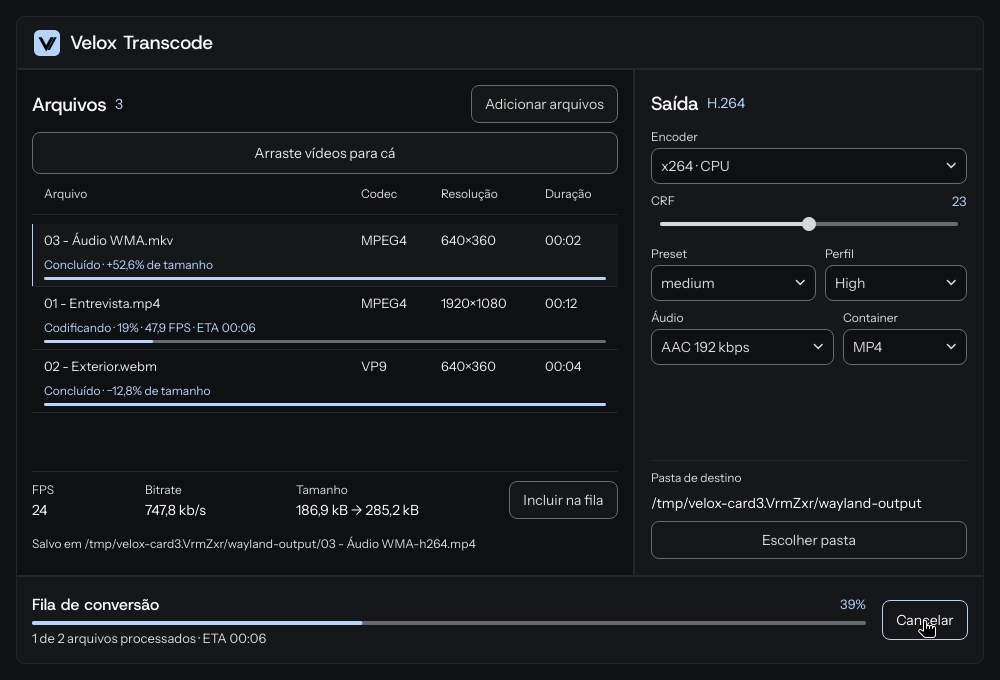

# Card 3 — Aplicação desktop

A janela usa Slint com Qt 6 e os [tokens do Velox](../DESIGN.md). O binário abre sem argumentos ou recebe vários caminhos locais em `cargo run --locked -- arquivo.mp4 arquivo.mkv`. A pasta de saída é escolhida antes de iniciar o lote.

- A coluna de arquivos lista codec, resolução e duração. Selecionar uma linha mostra FPS, bitrate, tamanho e o resultado ou erro daquele arquivo. Use **Excluir da fila** e **Incluir na fila** para mudar o próximo lote.
- O painel de saída oferece os encoders cuja sondagem passou. Qualidade 18–28, presets e perfis seguem as capacidades do alvo. Áudio oferece Copy ou AAC a 192/320 kbps e containers MP4, MKV e MOV. A UI oferece **Usar AAC 192 kbps** quando o container rejeita o áudio original.
- A fila mostra progresso individual e total, FPS e ETA quando disponíveis, redução ou aumento do tamanho e o caminho de saída. Uma entrada concluída sai da seleção automática e pode ser incluída de novo. Fechar durante um lote sinaliza cancelamento e aguarda os estados finais.
- O callback de conclusão envia o resumo via `notify-rust` em uma tarefa Tokio. Falhas no serviço D-Bus vão para o diagnóstico do processo, enquanto a janela conserva o resultado do lote. [API de notificação](https://docs.rs/notify-rust/4.19.0/notify_rust/)

## Verificações no Fedora Workstation 44

| Ambiente | Resultado |
| --- | --- |
| X11 no Xvfb 21.1.25 com Qt `xcb` | Entrada por argumentos e seletor XDG GTK, seleção da pasta e troca NVENC → x264 com setas e Enter. A janela respondeu à seleção de outra linha durante a conversão. Dois arquivos H.264 MP4 foram confirmados pelo ffprobe. |
| Wayland nativo no Weston 15.0.1 com Qt `wayland` | O protocolo registrou o app ID `dev.veloxtranscode.Velox` e o drop de dois vídeos. O seletor de pasta usou XDG Desktop Portal. A seta direita alterou a qualidade de 22 para 23. |
| Wayland com RTX 3070 Ti e D-Bus sem `org.freedesktop.Notifications` | MP4 com Copy rejeitou áudio WMA e mostrou a recuperação por AAC. A nova tentativa gerou H.264/AAC via NVENC e a janela continuou aceitando arquivos e comandos. |
| Cancelamento da fila em Wayland | Com um vídeo x264 em andamento e outro completo, o botão Cancelar preservou a saída pronta e deixou o diretório sem temporários. Fechar a janela durante uma nova tentativa também encerrou o job e limpou a saída temporária. |
| D-Bus isolado no teste X11 | Um receptor de QA confirmou uma chamada `Notify` com o ID da aplicação e o resumo de dois concluídos. |

Passaram `cargo build --locked`, `cargo fmt --all --check`, `cargo clippy --locked --all-targets -- -D warnings` e os nove testes de `cargo test --locked -- --include-ignored --test-threads=1`. A prova usou o portal GTK e um emissor de arraste GTK. O card 5 verifica registro MIME, agrupamento na dock, provedores de portal dos desktops de destino e instalação no Silverblue.
